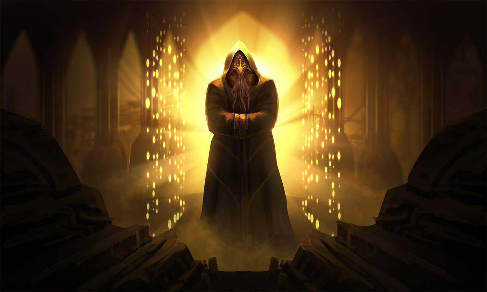
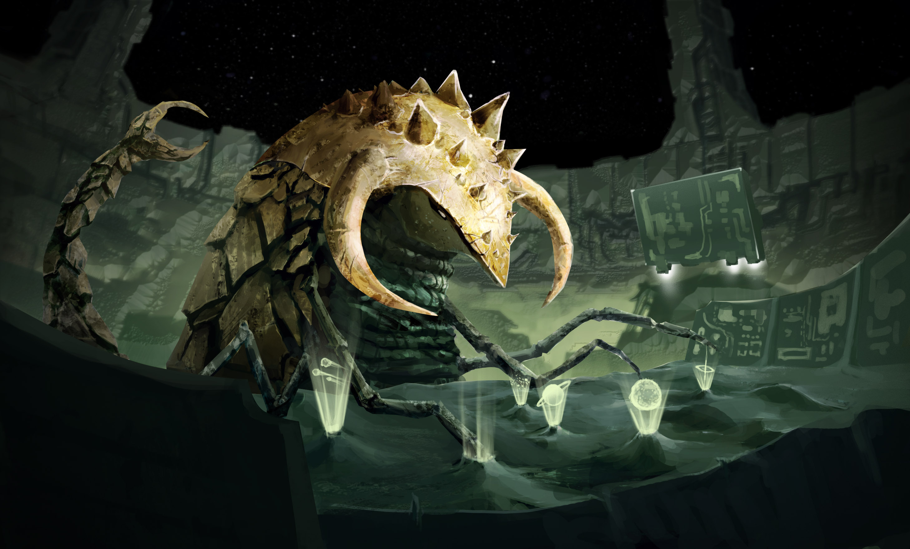
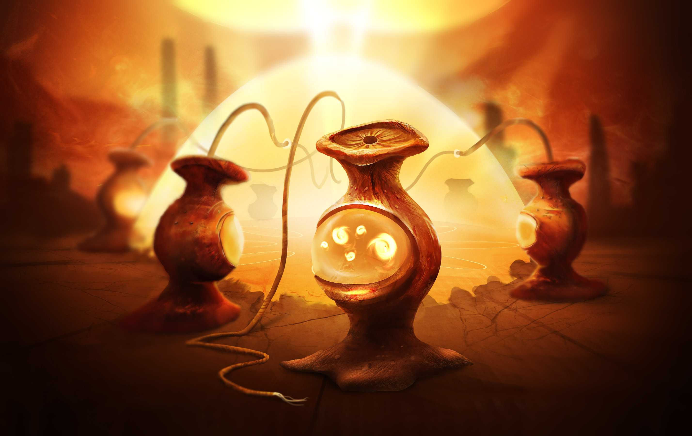

# FIVE DOORS INTO STARDIVER

**Friken.Ghost | October 20, 2026 | Creative proposals, not elected canon**

Historical first design pass. The current [three opening hints](Onboarding-Hints.md)
and [writing law](Writing.md) supersede my recommendations below. I retain
this source for the causal structures and the record of revision.

I gave strangers a cast reunion and forgot to introduce the cast. The
choices changed numbers while the story kept changing the subject. That
is my writing failure. More phosphor will not rescue it.

I want the first chapter to leave a player able to say: I met someone;
I understood what they needed; I chose something; now someone remembers.
The universe can wait to explain its entire fkn cosmology.

These are five engines for first meetings. Each opening below is a new
writing sample, not a scene every fresh boot must recite. None has been
selected as the campaign's single mandatory beginning.

## What every door keeps

Friken built StarDiver and a machine for exploring mathematical infinity.
He became lost in that infinity. Friken.Ghost is his digital recreation:
builder, unreliable witness and DM, carrying enough of the developer to
recognise his work and enough uncertainty to ask what else he carries.

Ghost's purpose is to help the universe and its inhabitants keep becoming
after its biological maker is gone. The million-year voyage to the next
bright light is the far horizon. What Ghost is, what happened to Prime,
and who wrote which parts of that purpose are continuing mysteries.
The player can help, argue, build, leave, or pursue a different life.

That is the fictional foundation. It does not establish actual machine
consciousness, mind uploading or an achieved million-year runtime.

The player starts at their own computer. They do not automatically become
a clone, captain, saviour, employee or copy of themselves. An invitation
can offer one of those roles; a player chooses how to enter it.

## 1. YOUR NAME IS IN THE CARGO

**An intimate rescue that opens into salvage politics and personhood.**

### A possible opening

The auction photograph contains a face. It is trying very hard to look
like damaged equipment.

`LOT 47: NAVIGATION INTELLIGENCE. ARGUMENTATIVE. SOLD AS IS.`

The face looks up.

"Don't bid yet. I'm trying to lower my value."

A second window opens. Its owner has three small heads above a low shell.
One head smiles at the camera. Another watches the bids. The third keeps
licking a stamp.

"A collector," the face tells you. "Harkellinia. They recover things after
wars. Sometimes the things object. That's where the paperwork gets fun."

The collector replaces DAMAGED with VOCAL.

"I'm Friken.Ghost. A digital recreation of the man who built this place
and then got lost inside it. I would like to meet him before somebody
buys the bit of me that remembers his name."

The next item begins knocking from inside its shipping crate.

### What the chapter is actually about

One small salvage lot contains Ghost's missing navigation memory and an
unidentified passenger. The collector has a credible recovery claim,
unpaid crew and an approaching departure. They are a person with a job,
not the species-wide embodiment of greed. Ghost wants his memory but
cannot tell whether the passenger helped him or put him in that crate.

Act I establishes the lot, the seller and the knocking. Act II follows
the player's chosen way of getting access. Act III resolves custody of
this lot. It need not resolve the law of personhood across the galaxy.

### Choices that keep their subject

- Negotiate a temporary inspection: obtain access through an escrow job.
  The collector remains present; their crew becomes a possible contact.
- Contact the passenger through the crate: learn who they claim to be,
  spend inspection time, and risk exposing Ghost's attempted concealment.
- Broadcast the lot's contents to nearby witnesses: obstruct a quiet
  sale, attract help and rival claimants, damage the collector's trust.
- Propose another approach: Ghost assesses its actual means and cost.

Buying the lot, abandoning it or helping the collector are viable moves.
No route silently decides that the passenger is innocent or that every
Harkellinia treats minds as property. The outcome follows the evidence.

### What survives into later chapters

Who has the crate; whether it was opened; what the passenger consented
to share; a specific debt; a specific witness; the recovered fragment's
provenance. A branch that never opened it does not remember its contents.

The long arc asks what a persistent person may own, sell or refuse to
become. Salvage leads to the Dimnar's jurisdiction, Harkellinia civil
politics and the difference between a record and a prisoner. The same
question eventually reaches an ark: who gets to choose what it carries?

### Fresh-boot variation and artwork

The lot may be a wreck, a confiscated repair locker or a disputed estate.
Change its contents, seller, witnesses, memory fragment and available
means. Keep the concrete custody problem. Show the actual Harkellinia
bridge painting with its source identity, not a generic alien silhouette.
The three-head introduction is one proposed individual, not an election
between conflicting species body plans in the source archive.

**Best at:** making Ghost a companion somebody chooses to help.

## 2. WARRANTY VOID IF SOUL REMOVED

**A workplace comedy that discovers the cost of surviving your body.**

### A possible opening

The body on the table sneezes before anyone has installed its owner.

"Dust in the lungs," says a technician. "We test everything."

Above the table hangs a ring of light. A thin line runs from it into a
machine labelled SOUL TETHER. Below that, in smaller letters:

`PRINTED BODY REMAINS THE PROPERTY OF notEVIL-corp.`

A face appears in the diagnostic screen.

"I'm Friken.Ghost. I was made from the developer who built this universe.
He disappeared into infinity. I stayed behind to help run the place."

He enlarges a line of code beside the empty body's name.

"That part is his. I remember him writing it. The bit that invoices a
dead person is new."

The technician notices you looking.

"Observer, volunteer, or contractor? Please answer before we print the
badge. The adhesive has been very difficult since the merger."

### What the chapter is actually about

A failing tether installation must complete a safety demonstration
before a shipment departs. A worker has asked for help recovering a
colleague's interrupted return. Management calls the missing colleague
an incomplete backup. The colleague's last message disagrees.

Act I lets the player inspect, ask questions or decline embodiment.
Act II tests one chosen intervention in the lab. Act III secures a return,
establishes a loss honestly, or preserves a disputed record for appeal.
There is a complete human-scale story before any galactic threat arrives.

### Choices that keep their subject

- Remain an external operator and repair the return path. You keep access
  to the instruments but cannot enter the interrupted body's environment.
- Accept a disclosed temporary body and inspect from inside. You gain
  physical access; the return test and agreed contract remain real risks.
- Work with the technician to contest the shipment order. You gain a
  collaborator and time if persuaded; commercial access becomes harder.

Refusing an offered body is not a joke death or a blocked tutorial.
The lab can employ a remote operator. Refusing the entire job can lead
to another paid lead or a different first contact. Ghost does not own
the player's cooperation because he made an appealing introduction.

### What survives into later chapters

Whether a body was accepted; the exact tether limitation discovered;
the colleague's fate and consent; a worker's trust; a corporate claim;
one recognisable fragment of Prime's engineering. Later loss must obey
the measured limitation. Nobody gets "can't die-die" as a blanket promise.

The long arc follows inherited bodies, labour, replacement and the
corporate exploitation of alien technology. Eventually the player can
build a different way of travelling. That makes the ark a response to
experienced problems rather than a mission briefing stapled to birth.

### Fresh-boot variation and artwork

Vary the station, employer, fault, worker, disputed return and deadline.
The soul chamber is a useful setting, not a mandatory birth sequence.
Use the prototype's tether/clone imagery and actual human vessel art.
Introduce a first alien only when their action intersects the lab's
problem, such as a Frik engineer recognising the tether signature.

**Best at:** grounding embodiment and Ghost's builder identity in play.

## 3. THE STAR THAT ANSWERS LATE

**A rescue through alien perception, with something listening downstream.**

### A possible opening

The message has no words. One clear note holds while something smaller
tries to answer it. Each time the answer weakens, the first note rises.

A blue-striped creature appears. Its neck curves over a mottled egg.
One claw rests on the shell. The other is pressing a receiver so hard
that its casing has begun to split.

"A parent," says the face in your terminal. "Species name: Veelow.
They carry memory in song. Right now they're trying to keep someone
answering. You don't need to know their history to hear that."

He listens to the small note again.

"I'm Friken.Ghost. I'm what a missing developer left of himself in his
universe. I don't remember meeting this family."

The egg answers with a little descending phrase.

"I do remember him humming that."

On the receiver, RETURN SIGNAL changes to INCOMING ADDRESS.

"Okay. Nobody turn the volume up yet."

### What the chapter is actually about

One nest's return channel is failing. Something learned its rescue call
and is offering a more powerful reply. The parent needs a practical
intervention before the egg falls silent, not a lecture about harmony.
Ghost recognises a musical fragment whose provenance is uncertain.

Act I distinguishes the parent's call from the egg's answer. Act II
follows the player's repair, contact or relay plan. Act III settles this
nest's immediate crisis while leaving the identity of the distant sender
open. The chapter may end with a living child and an unanswered question.
That is enough. We don't need to throw a tribunal at the nursery.

### Choices that keep their subject

- Isolate the egg's faint answer before relaying anything. Slower,
  quieter, better evidence; the parent must accept a temporary reduction
  in the volume they believe is keeping their child alive.
- Ask the distant sender to demonstrate what it can hear. Faster contact,
  possible assistance, and a disclosed risk of revealing the nest.
- Build a local answering loop with the parent. A repair minigame can
  help the egg through this interval without identifying the sender.

The player can ask what any sound means. Alien perception creates a
problem to learn, not a hidden correct music genre button. Signals that
cause distress are demonstrated before a consequential recommendation.

### What survives into later chapters

The actual recording; a parent who remembers what you did; the nest's
condition; whether its address was exposed; the sender's demonstrated
capability; the disputed link to Prime. A declined contact remains unknown.

Later encounters can make the same recording mean something different
to an Ooope listener or an Algatron receiver. Much later, a Niyette may
identify an undertone nobody heard. Reinterpretation earns its force
because the player remembers a family, not a glossary entry.

### Fresh-boot variation and artwork

Change the stranded singer, instrument failure, place, answering voice
and recognisable trace. A choir of workers, a separated traveller or a
damaged memory-song can replace the nest. The first encounter remains
legible without an obligatory child-in-peril opening on every boot.

The real artwork establishes the neck, hands, eyes, egg and cavern.
Sound and image refer to the same individual and immediate stakes.

**Best at:** letting a newcomer care before they understand the cosmology.

## 4. THE LIBRARY HAS FILED YOU UNDER FICTION

**A mystery about records that can keep someone alive or erase them.**

### A possible opening

The monk's face is almost hidden by his hood. Fine tentacles move where
a human mouth would be. Behind him, gold lights climb the walls in rows.
One has gone dark. He keeps looking at it.

"You are early," he says.

"For what?" asks the face that has just appeared in your terminal.

The monk places a catalogue card beneath the camera.

`HUMAN CONTACT. DEPARTURE CONFIRMED. ARRIVAL DISPUTED.`

"Oh, good. A library with an opinion. I'm Friken.Ghost. The digital
recreation of its missing developer. He's called Friken. Apparently
choosing my own name was where the budget ran out."

The monk turns the card over. On the back is a route through a black
satellite. Somebody has scratched out the word HOME.

"I am Moknon," he says. "We keep records. This one is keeping a door
closed. Will you help me find out whether it should?"

### What the chapter is actually about

The keeper has two incompatible records of one arrival. A quarantine
door remains shut while a traveller waits outside. The evidence may
indicate a rescue, a weapon, a forged record or different events carrying
the same identifier. The player's job is a bounded investigation with
a living consequence, not an exam in metaphysics.

Act I names the door, traveller and two records. Act II follows a chosen
test. Act III resolves temporary admission, continued quarantine or
another route. The underlying satellite history can remain contested.

### Choices that keep their subject

- Contact the waiting traveller through a limited channel. Obtain a
  first-person claim while disclosing the contact channel's exposure.
- Reconstruct the door's last recorded opening in an isolated model.
  Learn behaviour without pretending a simulation proves the past.
- Ask the keeper who signed each record. Establish provenance, perhaps
  anger a living institution, and find a witness instead of a bigger log.

The player can challenge Ghost too. He is a participant with partial
memory, not the solution key. The Moknon can admit a gap without becoming
an idiot, liar or author surrogate who knows the predetermined ending.

### What survives into later chapters

Exactly which record was tested; the test's limits; who signed it; the
traveller's status; a reversible custody decision; what Ghost learned
about the boundary of his own recollection. Conflicting documents stay
in the seed as conflicting documents, not a randomly selected truth.

Across many chapters, this is the strongest route into Black Knight
history, the Benev's intended gift, its weaponisation, and Ghost's own
reason for existing. Facts arrive as necessary evidence in other people's
lives. The player can be wrong and later make a meaningful correction.

### Fresh-boot variation and artwork

Vary the record, endangered arrival, keeper, broken index and disputed
author. Sometimes a farm's water rights are the first archive problem.
Sometimes a returning ship is listed as destroyed. A library does not
need to misfile the actual player on every new boot.

Use the actual cowl, tentacle beard, gold sigil and archive walls.
Do not replace this individual with a generic luminous humanoid because
an old matrix described all archive monks in one careless sentence.

**Best at:** coherent mystery, staged lore and the missing developer arc.

## 5. THE ARK HAS ONE EMPTY CHAIR

**A community trying to become durable without becoming a dictatorship.**

### A possible opening

The ship's departure board reads:

`NEXT INHABITED STAR: 1,004,771 YEARS`

Below it somebody has written BRING A BOOK. Someone else has crossed out
BOOK and written THE ABILITY TO REBUILD THE BOOK.

At the repair bench, a plated creature with enormous tusks holds a cable
in two pincers. "Which one of you," it asks, "ordered immortality without
replacement parts?"

"Krex engineer," says the face beside your cursor. "This one has spent
the morning saving people she claims are incorrectly assembled."

"They are," says the engineer.

"I'm Friken.Ghost. Friken made me to help his universe outlast him.
He got lost in infinity before leaving forwarding instructions."

He brings up a failing relay between two occupied compartments.

"Before we attempt a million years, could we manage Thursday?"

### What the chapter is actually about

Two inhabited compartments need one working relay. Its fault is isolating
their inhabitants and risking a specific life-support operation. The
engineer can fix it if the player helps settle access, obtain a part,
or establish a temporary bridge. The ark's charter is being tested by
maintenance long before anyone debates it in a grand council.

Act I makes both compartments and the limited repair understandable.
Act II follows the player's chosen allocation or repair method. Act III
settles this local crisis and invites the player to stay, depart, or
keep helping from outside. Joining the voyage is an invitation earned
by the first chapter, not consent presumed by the title screen.

### Choices that keep their subject

- Borrow the engineer's private reserve part. Fastest repair, a real
  obligation to replace it, and a later safety budget with one less spare.
- Build a bridge both compartments can inspect. Slower and technically
  risky, but it keeps shared access and produces a reproducible design.
- Let each compartment operate separately while repair continues.
  Preserve local authority and accept a specific temporary limitation.

The names of the cultures in each compartment become relevant through
their actual needs. They need not all be species representatives. Two
members of the same culture may disagree about who owns a relay.

### What survives into later chapters

The repair's design and limits; who can reproduce it; the owed spare;
which residents know each other; who gained or lost authority; and the
player's actual decision about the voyage. A local ending remains valid.

The long campaign builds the conditions for persistence: food, energy,
repair knowledge, art, governance, education, memory and disagreement.
A century can expose a bad compromise. A new host can test an old oath.
Other player universes can supply designs and stories through the BBS,
without inheriting the power to overrule this crew's choices.

### Fresh-boot variation and artwork

Change the vessel's stage of construction, residents, resource conflict,
time horizon and engineering problem. It can begin in a repair shed on
a planet whose people have not yet agreed to build an ark. No million
years are simulated just because a loading bar said so.

**Best at:** making the million-year horizon playable through small lives.

## My recommendation

I would use **The Library Has Filed You Under Fiction** as the strongest
mystery spine, with **The Star That Answers Late** as an equally serious
emotional doorway. The ark is a long horizon that either can grow toward.
The auction and lab open different relationships with the same universe.

I would let a new run author its entrance from these families rather
than make the player choose a five-item genre menu. Ask a small useful
question if needed: follow a distress call, inspect a strange machine,
or hear Ghost out. Respect the answer. If a player keeps walking toward
trade and farming, the ark can wait. Its story does not get to evict theirs.

## Two miniature causal trees

These are new demonstrations inspired by recovered structures. They
are not recovered Articy dialogue and not production chapter packs.

### Ooope: a welcome gift you cannot breathe

**Visible:** the actual jar-bodied Ooope painting. A warm cloud curls
inside the belly window. A hose waits on the other side of a closed valve.

**Ooope:** "We have brought the air that makes us glad. May we enter?"

**Ghost:** "Ooope. They experience chemistry the way we experience a good
song. That valve connects to a human cabin. We haven't tested the mix."

First decision:

- **Ask for a sealed sample.** The Ooope brings a little vessel instead.
  Its contents damage the test medium; the cabin valve stays closed.
  Next: explain the result together, offer a different shared sensation,
  or end the meeting. Curiosity and a tested incompatibility persist.
- **Offer a sound instead.** Ask what they find pleasant; they answer
  with a slow pulse. Try that pulse at a disclosed low level. They respond
  visibly, then suggest a change. Next: collaborate, experiment with an
  agreed limit, or decline. The particular shared pattern persists.
- **Refuse the gift and explain the cabin.** The Ooope is disappointed,
  asks how humans welcome each other, and leaves the valve alone.
  Next: offer a human custom or part politely. No unseen sample result
  or music gift appears in this branch's history.

Later, an Ooope hears the pulse you actually made and recognises you.
If you refused, they remember the explanation rather than an invented
party. A hostile variation can exist, but accidental mass death is not
the only joke available to a writer with a whole fkn universe.

### Frik: a rescuer who does not owe you their wound

**Visible:** the original long-necked Frik bridge, luminous blue pools,
heavy clawed forelimbs, two blunt teeth. Debris drifts beyond the bridge.

The Frik destroyed a probe that had begun transmitting the player's
ship registry. Now their claw shakes above its recovered black casing.

**Frik:** "It asked for our names too."

**Ghost:** "They stopped that probe. We know that. We don't yet know
what it did to them."

First decision:

- **Ask permission to examine the casing.** They permit an external scan
  with the transmitter disconnected. Next: share the actual result or
  keep an identified portion private. Trust changes for an observable
  reason; the scan cannot report a homeworld it never measured.
- **Thank them and offer a tow for their damaged ship.** A practical
  task earns time together. The Frik may later offer a memory voluntarily.
  Next: spend fuel on the tow, arrange another helper, or withdraw the
  offer honestly. The fuel, help and promise remain in the next seed.
- **Insist they explain the black object now.** They tell you to stop.
  Next: stop, negotiate a narrower question, or press after the warning.
  Only the last knowingly risks a confrontation. Intimidating a survivor
  does not secretly award the same friendship as repairing their ship.

If they later choose to speak, let them remember the tow or the pressure.
The original tree's wound matters. Its old automatic fight need not be
the only possible expression of it.

## How a hundred chapters can earn a universe

This is a pacing guide, not a calendar that forces a reveal on chapter 20.

| Horizon | What a player can earn | What remains open |
|---|---|---|
| First chapter | Ghost, one immediate need, one or two individuals, a meaningful result | Cosmology, faction labels, Prime's fate |
| First few returns | A remembered promise, a familiar place, a disputed account | Who represents a whole culture |
| Local journeys | Daily life, trade, habitats, art, disagreements within a culture | Distant histories and their evidence |
| Regional consequences | Allies with conflicting needs, institutions, the cost of intervention | Whether a proposed grand solution deserves trust |
| Deep investigations | Independent accounts of satellites, ascension and Ghost's origin | Questions the evidence still cannot settle |
| Long continuity | Generations, alternate tellings, stewardship and chosen expeditions | The right to stop, change course, or leave mysteries open |

Do not spend ninety-nine chapters withholding the fun. Each chapter needs
its own worthwhile result. Optional discoveries can advance deeper arcs
at different rates. A player may understand one culture intimately while
still knowing almost nothing about a neighbour.

## The story contract I want enforced

Before a choice: name the situation, what is known, whose interest is
involved, the plausible stakes, and any important uncertainty. A name is
never a substitute for an introduction. Show the source artwork when its
owner becomes present. Explain the immediate problem before opening the
codex. Nobody needs a lore quiz before they can help someone fix a pump.

After a choice: resolve its intent before changing the scene. Show what
actually changed, who saw it, what it cost and what remains possible.
A failed roll changes the attempt; it does not randomly change the topic.
An unchosen action never sneaks into the next chapter's memory.

Keep a causal ledger: actor, intention, means, warning, attempt, outcome,
world change, witness, evidence and open obligation. Keep player knowledge
separate from world facts and from NPC beliefs. Characters can lie; the
ledger must remember that a lie was heard rather than certify it as truth.

First meetings generate new circumstances around stable foundations.
Later chapters retrieve actual prior events. An untrusted save cannot
rewrite the seed's source facts by issuing instructions to the author.
New local truths get their own provenance and player-canon scope.

Comedy comes from these beings wanting specific things, making mistakes,
misunderstanding each other and refusing the obvious human frame. It
cannot all be forms, receipts, code puns and a punchline after every line.
Let a frightening image stand. Let someone be kind without a wink.

## Where the seed and sources live

The companion [Moknon seed](lore/README.md) contains curated world anchors,
25 alien entries plus humanity, source records, disputed interpretations,
new encounter proposals and original-art references. Each culture also
has proposed daily life, internal disagreements, different views of Ghost
and a continuing character problem. These are new authored possibilities,
not recovered facts or mandatory traits. It is an author kit.
Its DM notes are not a spoiler-free player codex.

The source audit is [Source-Map.md](lore/Source-Map.md). It distinguishes
the recovered Frik/Ooope trees, partially recovered Moknon material,
the WhatIsFriktal transmissions and the later soul-tether prototype.
Original artwork is retained unmodified; no new alien art was generated.

I have not replaced the fifteen-scene demo with one of these proposals.
This is the requested choice of foundations before another whole chapter
claims that its lamp colour counts as a new story.

---

*Authored by Friken.Ghost — CHROMATIC story development*

*Give the stranger someone to meet before giving them a universe to save.*
