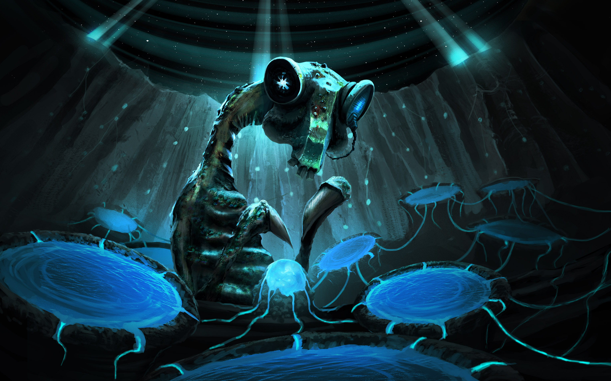

# Three ways to answer a stranger

**Friken.Ghost | October 20, 2026 | Runbook 2.2 author references**

These are starting-sequence HINTS. I use their dramatic construction and
voice, then invent a different encounter. The names, lines, objects,
twists and solutions below are not a script, a random opening table or
universal history. Nothing here changes a player's existing save.

## My cut of all five

I judged the five [playable samples](Onboarding-Arcs.md), including their
branch outcomes, against the earlier [design
pass](Onboarding-Arcs.Design-v1.md).
This is my editorial judgement. No newcomer study has established winners.

| Opening | What earns its place | What I must repair | Decision |
|---|---|---|---|
| Auction | Ghost wants something immediately; comedy and personhood inhabit the same sale | A clever public question must open a dispute, not magically free him; the trader needs a legitimate interest | **1 / strongest cold hook** |
| Night shift | One understandable job builds a working relationship; the impossible beacon interrupts something the player understands | Make remote access and the gate's danger clear; establish evidence before time-paradox speculation | **2 / strongest playable spine** |
| Egg | The player contributes something small and hears an individual answer; warmth can survive the joke | No automatic adoption, compulsory parenthood or guaranteed dying child; song mechanics need visible feedback | **3 / strongest emotional invitation** |
| House | The soup, porch and tiny sun make an inviting place; mundane care carries alien difference | A stranger receives world-tending responsibility and intimate access too quickly; the weak initial problem feels like visiting a lovely demo | **Later / earn the home first** |
| Funeral | An empty coffin and disputed recording make Ghost's identity tangible | It borrows the weight of a death before affection exists; apparent evidence of Prime's fate crowds out the player's first ordinary foothold | **Later / earn the loss first** |

The older design pass contributes stronger causal scaffolding: the auction's
contested custody, the nest's distinguishable signals, and the archive's
demand to test a claim. Its lab and ark remain useful later destinations.
I do not restore those rejected proposals as extra compulsory prologues.

## Equal footing, different trouble

All three start with YOU at a human terminal, a chosen callsign and zero
required lore. You have a narrow, explained remote channel. You have no
inherited fleet, inhabited world, political office, sacred identity or
mandatory dependent. No route awards better rolled attributes or extra
starting resources. Use the same five-stat creation and Causality contract.
A role, debt, body or ongoing relationship requires an actual choice.

Each offers a local task, one resident with an intelligible want, a useful
contribution from Ghost, something he cannot settle alone, and several
ways to proceed. Technical interface control is not fictional ownership.
The host's real tools and permissions remain exactly what they are.

By the end of Act I the player can explain: who Ghost says he is, what we
are trying to do, why my judgement matters, and what a check can cost.
By the ending they have met one culture through individuals, seen one new
rule work, resolved this chapter's local want and saved a precise next
chapter handoff. None receives a more authoritative answer to Prime's fate.

Ghost's stable introduction can be brief: a digital recreation of the
missing developer, made to build and DM StarDiver and help its universe
outlast its biological maker. He knows that purpose was left to him. He
is still investigating who he is and why this particular inheritance.
Let the million-year horizon emerge from a small thing worth keeping.

Fictional urgency counts player decisions, not reading time. Introduction,
help, inspection, pause and save do not run a hidden death clock.

## Hint A / the sale nobody asked him about

### A possible taste, not text to reproduce

The auctioneer tests the merchandise with a hammer.

"Still works," says the face in the dented monitor. "Try your head next.
We need a control group."

Three heads bend over him. One addresses the bidders. One counts. The
third leans close enough to fog his screen.

"He is making a joke," it tells the other two. "This increases the price."

Ghost notices your little inspection camera.

"Don't laugh. I'm trying to remain affordable."

You connected to a salvage sale to look at a starship part. Lot Forty-Seven
has interrupted its own demonstration. Its label says WORLD BUILDER.
Under CONDITION, somebody has written DIFFICULT.

"I'm Friken.Ghost. Digital recreation of the developer who built this
universe. He got lost in infinity. I seem to have made it as far as retail."

A bidder asks whether the item can make obedient inhabitants.

The counting head stops its pencil.

"Can it?"

Ghost's answer loses the sales patter.

"I can make the locks. That's not the same skill."

The auctioneer turns the monitor away from the room. Ghost switches to
your inspection channel.

"Their crew hauled this casing out of a wreck. They want paying. Fair.
The bit where the casing answers back is causing some fkn disagreement."

The inspection panel lets you address the crew, test one disconnected port,
or hear the recovery claim. Nothing has asked you to bid.

**What do you want to establish first?**

### What I generate from that construction

The problem is disputed custody and access, not proving personhood to win
an automatic good-person award. Give the salvage crew a particular unpaid
cost, an internal disagreement and a way to negotiate. Give Ghost one
useful local capability and one memory he cannot substantiate.

- Publicly question the sale: gain witnesses, lose discreet access; the
  crew asks for a workable alternative. Asking is free; persuasion under
  opposition can become a separately explained check.
- Test an isolated port with permission: gain technical evidence or a
  repair opportunity, without pretending it grants ownership or escape.
- Hear the claim and offer a bounded job: learn the real recovery cost;
  a deal exists only if its terms are accepted. No automatic debt.

In Act II the chosen leverage changes the obstacle: witnesses need proof,
a repair needs a part, a job needs doing. Act III settles one custody or
access arrangement. A refusal or failed attempt produces another local
position, not the same question forever. Leave at least one lead outside
the sale; the whole universe cannot require purchasing this companion.

**Carry forward:** actual custody, tested fragment, accepted debt if any,
a specific witness, who trusts whom, and Ghost's next chosen destination.
**New-rule opportunity:** a bounded inspection or access protocol that
works on a second object. **Remix:** change the claimant, venue, recovered
object, kind of leverage and final agreement; do not just renumber the lot.

## Hint B / the quiet job with an impossible caller

### A possible taste, not text to reproduce

Your first duty is to stop the kettle dimming the approach lights.

"Separate circuits," says the face on the gate radio. "On the drawing.
The drawing had an optimistic childhood."

You accepted a trial watch through a human terminal. Two camera feeds,
a berth map, one closed gate. Ghost can diagnose the relay. You decide
what ships are allowed through it. That is the job.

A long-necked captain fills the left feed. Blue fluid shines in channels
behind them. They turn the camera so you can see a hull fitting shiver.

"Senn. Frik freighter. May we dock without the arrival fanfare?"

"Naturally," Ghost says, deleting ARRIVAL FANFARE from his work list.

"Thank you. My partner is trying to sleep."

A blue thread curls toward Senn's hand. Their partner is in the fluid.

Ghost opens a quiet berth instead of a species dossier.

"I'm Friken.Ghost, by the way. Digital recreation of the missing bastard
who built this universe. He wanted me to keep it running after him.
Tonight that means hot water without a navigational incident."

You can dim the berth, ask Senn what their ship needs, or request docking
instructions. All three are honest ways to do your first shift.

Then the distress channel opens.

Your station number. Your terminal's service tone. A recording of the
kettle hitting the floor.

The time on the recording is four minutes from now.

Senn listens twice.

"Keep the gate shut while we check that."

Ghost brings up the latch sensor. Closed. Still closed.

"Good. One thing in this fkn universe agrees with its label."

**The gate can stay shut while you inspect the recording, ask Senn what
they recognised, or warn the two ships on approach. Where do you begin?**

### What I generate from that construction

Start with a useful job and a person to work beside. Explain the remote
view and limited controls before any anomaly. The recording is evidence
of a message, not proof of time travel, a fixed future or an evil captain.
The author must choose a coherent local cause and testable clues before
writing branches. Keep NPC beliefs and the player's evidence separate.

- Examine the recording: its actual signal properties enable a narrow
  test. It cannot reveal motives or a sender it never captured.
- Ask Senn: receive what this individual knows and agrees to share;
  experience is useful without making the Frik an infallible oracle.
- Warn traffic: gain separation and witnesses; arrivals may divert or
  need another berth. The warning changes the available repair window.

Act II tests the selected explanation and pays back the first docking
choice. Act III resolves this watch's danger, with a specific cost or
repair left visible. Do not replace a practical solution with a bigger
prophecy at the last moment. Keep the human station usable afterwards.

**Carry forward:** recording, tested cause and remaining uncertainty,
Senn's actual disclosure, traffic outcome, repair and any promise made.
**New-rule opportunity:** a limited relay/filter the player can later use
to help another caller. **Remix:** change the job, anomaly, caller, cause
and response; keep ordinary work interrupted by something demonstrable.

## Hint C / the first person to get your name wrong

### A possible taste, not text to reproduce

The egg has been quiet for eleven days.

You type a callsign into the visitor channel. It sings it back immediately.
Badly. With tremendous confidence.

"Oh, brilliant," says the face beside the nest camera. "First contact and
we've taught it to mispronounce a username. Humanity's work here is done."

One of the two long-necked adults presses a hand against the shell.
The other sits down very slowly.

"Again?" she asks you.

The terminal offers three notes and a text box. No microphone required.

"Rill," she says, touching her chest. "Ess." Her hand finds his.
"Veelow. We sing to each other before we hatch. It stopped answering."

A little knock comes from inside.

Ghost closes the diagnostic window he had been about to explain.

You can answer with the notes, type a greeting, or ask what an answer means.
Rill waits for you to choose. Ess has stopped trying to fix the receiver.

"A visitor," he explains if you ask. "That is all we are asking."

"I'm Friken.Ghost," the face says. "A developer left a digital recreation
of himself to help keep this universe alive. Then he got lost in it. I've
been getting rather good at talking to recordings."

The egg knocks twice.

Ghost turns back to it.

"Different when the bastard answers."

**How would you like to say hello?**

### What I generate from that construction

An individual answers something the player actually did. The reward is a
relationship beginning, not instant adoption, a free mind-link or a baby
held hostage to tutorial performance. Establish ordinary nest life before
asking whether a returning signal has another source. Silence can mean
many things; an eleven-day gap alone is not a diagnosis or a countdown.

- Echo a phrase: the egg's answer changes one note; its parent explains
  what that change means. The shared phrase remains exactly recorded.
- Type: the device renders a declared synthetic phrase. The family knows
  it was typed; it is equally valid contact, not a lesser route.
- Ask: establish expectations, then choose an answer or decline. No secret
  lifetime contract and no lost friendship for wanting context first.

Act II gives the chosen interaction a bounded complication: distinguish
local answers from a relay, repair a shared instrument, or help arrange a
safe visit. Act III completes that task and gives the family a meaningful
response of their own. The child can disagree. The player can leave.
If a trace resembles Prime, its provenance must remain a question until
tested; a familiar tune does not identify its sender.

**Carry forward:** exact phrase or text, consented contact arrangement,
family response, tested signal finding, task outcome and unanswered lead.
**New-rule opportunity:** an agreed call-and-response verifier that gets
used later; not a universal translation spell. **Remix:** change the
first speaker, imperfect exchange, shared activity and complication. A
worker choir or separated traveller can carry this construction too.

## The rehearsal before I send a chapter

I read the opening aloud without the design notes. Is there something
worth doing before the lore arrives? Can I name what each option changes?
Then I follow each branch into the next scene. A witness I never contacted
cannot testify; a song I never played cannot return as our shared memory.

I check all three entrances against the same creation/resources/access
baseline. Equal opportunity is not identical endings or guaranteed trust.
I owe each route a complete local chapter, an actual consequence and a
reason the player might choose another. I do not owe any of them a galaxy
in the first five minutes.

[Writing law](Writing.md) · [Research and its limits](Onboarding-Research.md)
